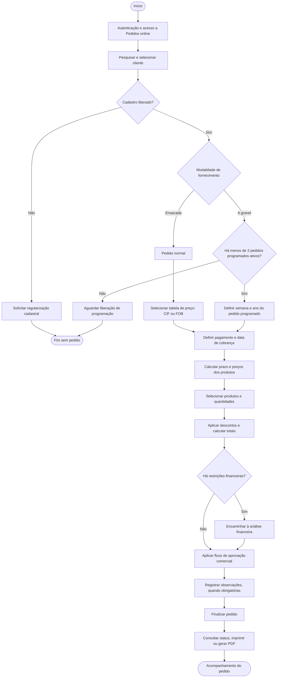
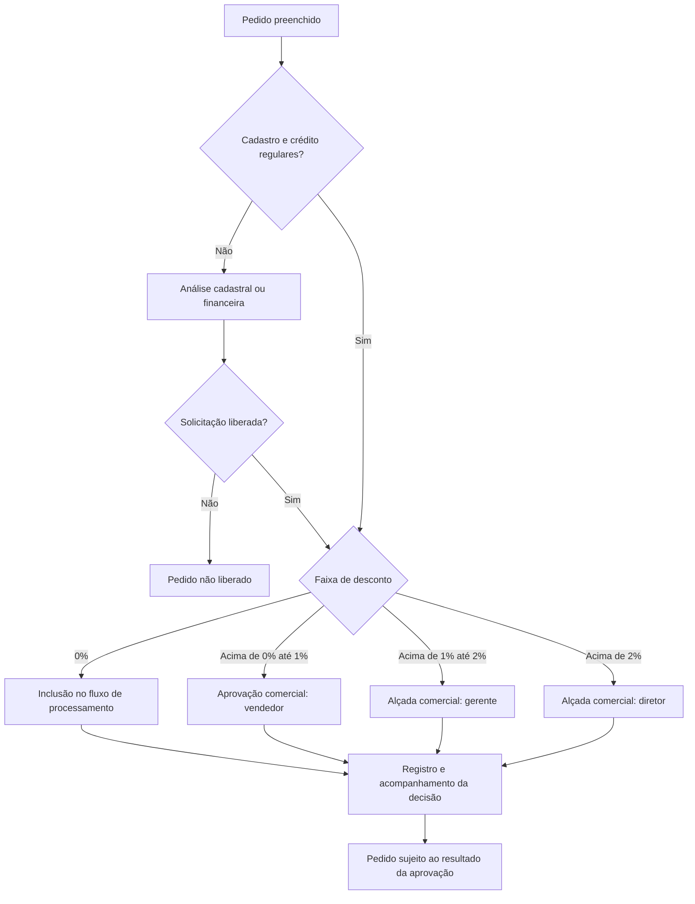

# eBella-ERP-Sales

### Gestão comercial, pedidos, clientes e operações corporativas

**Portfólio funcional de uma plataforma web para gestão de vendas e processos comerciais**

`Gestão comercial` · `Pedidos online` · `CRM` · `Financeiro` · `Logística` · `Relatórios`

---

## Visão geral

O **e-Bella** é uma plataforma web concebida para apoiar o ciclo comercial, desde a consulta e o cadastro de clientes até a emissão de pedidos, o tratamento de condições financeiras e o acompanhamento das entregas.

A solução documentada reúne módulos de vendas, relacionamento com clientes, contas a receber, relatórios, metas, localização de unidades de armazenamento, documentos fiscais e comunicação interna. O foco é a organização de processos empresariais com regras de negócio e diferentes níveis de aprovação.

> **Natureza deste repositório:** portfólio técnico-funcional elaborado a partir da documentação histórica do sistema. Esta publicação contém **somente uma descrição das funcionalidades e dos fluxos**. Não disponibiliza vídeos, imagens das telas, manual original, dados cadastrais, código-fonte proprietário ou banco de dados. As características aqui descritas refletem o material histórico, não a disponibilidade atual do software.

## Índice

- [Módulos e funcionalidades](#módulos-e-funcionalidades)
- [Fluxograma do processo de pedidos](#fluxograma-do-processo-de-pedidos)
- [Regras de negócio](#regras-de-negócio)
- [Fluxograma de aprovações comerciais](#fluxograma-de-aprovações-comerciais)
- [Gestão e acompanhamento](#gestão-e-acompanhamento)
- [Aspectos técnicos e escopo](#aspectos-técnicos-e-escopo)

## Módulos e funcionalidades

| Módulo | Funcionalidades documentadas |
| --- | --- |
| **Acesso e painel inicial** | Autenticação com credenciais, notícias e avisos, atalhos para pendências financeiras e mensagens. |
| **Pedidos online** | Seleção de cliente, modalidade de pedido, tabela de preços, prazo, produtos, quantidades, descontos, observações e fechamento. |
| **Meus pedidos** | Consulta por filtros, histórico, status de aprovação ou cancelamento, visualização detalhada, impressão e geração de relatórios. |
| **Cadastro de clientes** | Registro de dados cadastrais e envio de documentação para avaliação antes da liberação. |
| **Clientes / CRM** | Pesquisa, histórico de compras, última compra e informações comerciais por cliente. |
| **Clientes de produtos a granel** | Histórico de pedidos, identificação da condição do silo e localização de armazenamento. |
| **Consulta financeira** | Limite de crédito, títulos vencidos, valores em aberto e vencimentos futuros. |
| **Comissões** | Relatórios de comissões por período, itens vendidos e totalizadores. |
| **Metas de vendas** | Indicadores de metas, comparação entre realizado e previsto e relatórios de descontos. |
| **Mapeamento de silos** | Visualização geográfica, data da última compra e quantidade de pedidos programados. |
| **Entregas** | Consulta do andamento de pedidos e visualização da rota do veículo durante a entrega. |
| **Documentos fiscais** | Pesquisa de documentos fiscais por chave, código fiscal ou período e obtenção em PDF e XML. |
| **Comunicação** | Caixa de mensagens, envio, contatos, grupos, pastas e preferências de correspondência. |
| **Banco de arquivos** | Consulta e obtenção de documentos disponibilizados aos usuários. |
| **Preferências de acesso** | Alteração de senha e encerramento da sessão. |

## Fluxograma do processo de pedidos

O fluxo abaixo sintetiza os procedimentos de pedidos descritos no manual, distinguindo **pedidos normais de produtos ensacados** e **pedidos programados de produtos a granel**.

> O fluxograma representa as **etapas e as verificações previstas** no processo. Uma solicitação sujeita à análise financeira ou comercial não é considerada aprovada automaticamente.

## Regras de negócio

### Modalidades e programação

- **Produtos ensacados:** operação descrita como **pedido normal**, com tabela de preços **CIF ou FOB**.
- **Produtos a granel:** operação descrita como **pedido programado**, com definição de **semana e ano** e previsão de entrega.
- **Limite de programação:** até **3 pedidos programados ativos por cliente**. Depois da entrega, o pedido deixa de ocupar uma vaga na contagem documentada.
- **Formas de cobrança:** modalidade não parcelada ou parcelada; o exemplo de parcelamento do manual divide a cobrança em **duas parcelas**, com a segunda prevista **30 dias depois** da primeira.
- **Formação de preços:** o prazo selecionado é considerado no cálculo dos valores apresentados para os produtos.

### Restrições comerciais e financeiras

| Condição identificada | Tratamento descrito |
| --- | --- |
| **Cadastro pendente / bloqueado** | Impede a realização do pedido até a regularização. |
| **Limite de crédito ultrapassado** | Permite elaborar a solicitação, mas depende de análise e aprovação financeira. |
| **Títulos vencidos** | Permite elaborar a solicitação, mas exige análise e aprovação financeira. |
| **Desconto solicitado** | Encaminha o pedido para a alçada correspondente à faixa de desconto. |
| **Desconto ou prazo superior a 50 dias** | Exige justificativa no campo de observações. |

O campo de observações mencionado no manual aceita até **500 caracteres**. As regras acima representam o comportamento documentado na versão histórica.

### Faixas de aprovação de descontos

| Faixa de desconto | Alçada indicada no manual |
| --- | --- |
| **Sem desconto (0%)** | Inclusão automática no fluxo de processamento/aprovação do pedido. |
| **Acima de 0% até 1%** | Aprovação do vendedor. |
| **Acima de 1% até 2%** | Aprovação do gerente. |
| **Acima de 2%** | Aprovação do diretor. |

A representação gráfica original apresenta uma **cadeia de aprovações**, com participação de níveis anteriores nas faixas superiores. A tabela resume a **alçada máxima** de cada faixa; não descreve os detalhes de implementação ou de autorização interna.

## Fluxograma de aprovações comerciais

## Gestão e acompanhamento

### Histórico de pedidos e entregas

O módulo de pedidos permite filtrar registros por características comerciais, consultar o status e identificar solicitações canceladas. Os detalhes do pedido podem ser consultados, impressos ou exportados, conforme as opções apresentadas na documentação.

Durante uma entrega em andamento, o sistema documenta a possibilidade de consultar a **rota de deslocamento do veículo**, com pontos de localização e registros associados ao trajeto.

### Gestão de clientes e informações financeiras

O relacionamento comercial reúne **cadastro**, **histórico de compras**, **data da última compra** e **consulta financeira**. Para clientes com fornecimento a granel, também é possível verificar a **localização do silo** e a situação dos pedidos programados.

### Indicadores e relatórios

Os módulos gerenciais incluem acompanhamento de **metas comerciais**, **comissões de vendas**, análise de **descontos positivos e negativos** e emissão de relatórios. A documentação registra opções de exportação de dados para planilhas e consulta/impressão de documentos em formatos eletrônicos.

### Documentos e comunicação

O ambiente documenta pesquisa de documentos fiscais com download em **PDF ou XML**, além de **caixa de mensagens**, catálogo de contatos, pastas de correspondência, configurações de envio e **banco de arquivos** para documentos disponibilizados aos usuários.

## Aspectos técnicos e escopo

Este case demonstra a especificação de fluxos e regras relacionados a:

- **Gestão de processos comerciais:** do cadastro de clientes ao acompanhamento de pedidos e entregas.
- **Regras de negócio:** cálculo de prazos, descontos, limites e alçadas de aprovação.
- **Integração de domínios funcionais:** comercial, financeiro, logística, documentos e comunicação.
- **Consultas e relatórios:** histórico, filtros, indicadores e formatos de exportação.
- **Organização de acessos:** autenticação, preferências da conta e operações disponibilizadas ao usuário.

**Limites de verificação:** este repositório não contém o código-fonte do sistema. Por isso, a documentação **não atribui frameworks, versões, linguagem de implementação, infraestrutura ou arquitetura interna** sem evidência técnica.

---

**Publicação de portfólio:** material estritamente descritivo, sem nomes de pessoas ou empresas, vídeos, capturas de tela, informações de clientes ou documentos originais. Nenhuma licença de uso sobre software ou dados de terceiros é concedida por este README.
